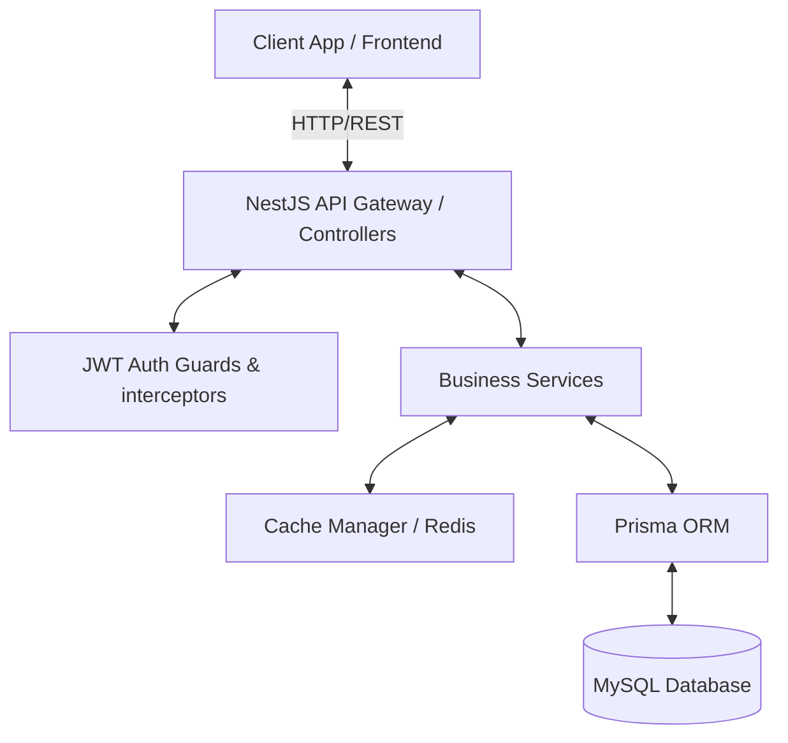

# Onboarding & System Architecture Guide

Welcome to the **DevConnect Backend** project! This guide provides an overview of the application flow, system architecture, core technical concepts, and folder structures to help you get up to speed quickly.

---

## 1. High-Level Architecture & Tech Stack

DevConnect is built as a modular NestJS web application, acting as the API backend for the DevConnect system.



### Core Technologies
*   **Framework**: [NestJS](https://nestjs.com/) (v11) - a progressive Node.js framework for building efficient, reliable, and scalable server-side applications.
*   **Database ORM**: [Prisma](https://www.prisma.io/) (v6) - modern database toolkit for type-safe database access (MySQL).
*   **Authentication**: [Passport JWT](http://www.passportjs.org/) + [bcrypt](https://github.com/kelektiv/node.bcrypt.js) for secure password hashing and stateless request verification.
*   **Caching**: [@nestjs/cache-manager](https://www.npmjs.com/package/@nestjs/cache-manager) backed by [KeyvRedis](https://github.com/jaredwray/keyv) / Redis for high-performance reading.
*   **Logging**: [Winston](https://github.com/winstonjs/winston) + [Winston Daily Rotate File](https://github.com/winstonjs/winston-daily-rotate-file) for structured logging to files and stdout.
*   **API Docs**: [Swagger (OpenAPI)](https://swagger.io/) for auto-generated interactive documentation available at `/api`.

---

## 2. Core Technical Concepts

### A. Authentication Flow (JWT)
DevConnect uses stateless JWT (JSON Web Tokens) to authenticate requests.
1.  **Sign Up**: The client posts to `/v1/auth/signup` with registration credentials. The `UserService` hashes the password with `bcrypt` (10 rounds) and saves the user record.
2.  **Log In**: The client posts to `/v1/auth/login`. The server compares credentials using `bcrypt.compare`. If correct, the `AuthService` signs a JWT containing the user id (`sub`) and email, returning an `access_token`.
3.  **Authenticated Requests**: Authenticated routes require an `Authorization: Bearer <token>` header. The `JwtAuthGuard` intercepts requests, validates the signature via `JwtStrategy`, and appends the validated identity payload to `req.user`.
4.  **Current User**: The `@CurrentUser()` decorator provides a type-safe way to extract the user object directly from the request object within controller handlers.

### B. Type-Safe Caching (Cache-Version Pattern)
To speed up reads, read queries (such as listing articles or projects) are cached using NestJS `CacheModule`.
To prevent stale cache data, the codebase implements a **Cache Versioning Pattern**:
*   Every list query cache key has a structure: `[entity]_v[version]_page_[page]_limit_[limit]`.
*   A special version counter (e.g., `article_version`, `project_version`) is stored in the cache store.
*   When a user creates, updates, or deletes a resource, the service triggers `invalidateArticlesCache()` or `invalidateProjectsCache()`, which increments the version counter.
*   Subsequent read requests resolve to a new cache key version, naturally invalidating older entries without executing complex pattern deletes on Redis.

### C. Type-Safe Database Operations with Prisma
All database interactions are managed by the `PrismaService` which extends `PrismaClient`.
*   **Schema Definition**: Defined in `prisma/schema.prisma`. It represents relational tables for Users, Articles, Projects, Tasks, Messages, and Permissions.
*   **Type Safety**: Running `npx prisma generate` builds type definitions based on the schema into `node_modules/@prisma/client`. When writing service logic, models are strictly typed to prevent runtime failures.

---

## 3. Directory Structure

```bash
src/
├── app.module.ts            # Root module registering all submodules, cache managers, and global guards
├── main.ts                  # Application entry point configuring validation pipes, CORS, Swagger, and logging
├── auth/                    # Auth controllers, JWT strategies, and decorators
├── user/                    # User service, DTOs, and controllers
├── article/                 # Articles management (caching, mapping utils, and controller)
├── project/                 # Projects and Tasks (includes Prisma transactions for updating tasks)
├── snippet/                 # Snippets management with Tag relations
└── common/                  # Reusable utilities
    ├── prisma/              # Prisma database connection service
    ├── logger/              # Winston logging configuration
    ├── filters/             # Global error interceptors (e.g., PrismaExceptionFilter)
    └── interceptors/        # Global request loggers (WinstonLoggingInterceptor)
```

---

## 4. Onboarding Checklist & Getting Started

Follow these steps to run the application locally:

### 1. Environment Configuration
Ensure you have a `.env` file containing:
```env
DATABASE_URL="mysql://<user>:<password>@localhost:3306/devconnect"
JWT_SECRET="yourSuperSecretKey"
REDIS_URL="redis://localhost:6379"
PORT=3000
FRONTEND_URL="http://localhost:5173"
```

### 2. Install Dependencies
Run the package installation:
```bash
npm install
```

### 3. Generate Prisma Types & Run Migrations
Generate local Prisma client type definitions and sync your database:
```bash
npx prisma generate
npx prisma db push
```

### 4. Start the Application
To run the server in development mode with hot-reloading:
```bash
npm run start:dev
```

Once running, visit **`http://localhost:3000/api`** in your browser to inspect the Swagger documentation and test the available REST endpoints!
